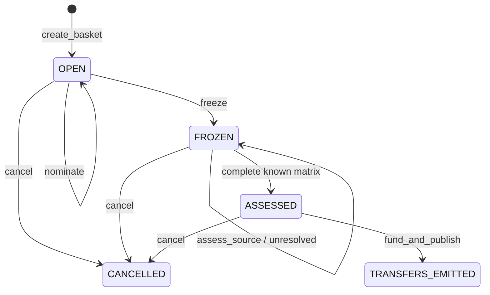

# SpecBasket — Standards, substantiated.

SpecBasket is a research workspace for Ethereum development teams. A sponsor defines
up to three specification requirements; invited contributors nominate official ERCs.
GenLayer independently assesses the complete documents, and deterministic matching
allocates at most one research award per requirement and per selected ERC.

Website: [specbasket.vercel.app](https://specbasket.vercel.app) · [GitHub](https://github.com/eaglebooth/SpecBasket)

## Release status

Current source v0.2.0 is deployed at **0xb2ee483d3874b72aF6958BCa0E73562d406FbfE9**.
Independent verification passed **37 SDK parent transactions and 3 native-transfer children**,
with exact deployed source parity and zero remaining contract balance. Happy path,
negative/replay controls, adversarial requirements and a cancellation race were observed.
See [live transaction index](docs/LIVE_E2E_EVIDENCE.md),
[payment delivery](docs/PAYMENT_DELIVERY.md), and
[real UI readback](docs/live-evidence/UI_LIVE_READBACK.json).

83 controlled contract tests, 14 client tests, lint, schema and production build pass.
Browser wallet signing is deferred by the user; UI readback is verified without signing.
Positive eligible failed-deposit recovery remains controlled-only; cross-instance recovery
probe was unresolved and emitted nothing. These are explicit limits, not passed live gates.
Production Vercel deployment and real RPC UI readback are verified; see [production evidence](docs/DEPLOYMENT.md).

Historical v0.1.0 at 0x65Bc42A6263De86C6Aa1D0DE8a6021b630A5656d FAILED native-value
rollback; its 1 wei remains on that old instance. The frontend permits only reading it.
See [historical evidence](docs/HISTORICAL_V010_EVIDENCE.md). Old transactions do not
establish v0.2.0 behavior. Constructor has no arguments. User main wallet deploys only;
secondary accounts exercise roles.

## Why GenLayer

A document can mention royalties without requiring every marketplace to pay them.
Understanding normative clauses, exceptions and whether they establish an exact
requirement needs semantic judgment. Validators independently fetch the fixed
revision and re-derive every consequential matrix relation. Code selects the matching,
checks sender/state/commitments/value and emits the exact award/refund messages.

## Three authorities

- Sponsor sender: defines its own brief, contributor roster and optional reward.
- Fixed ethereum/ERCs publication: authority only for exact specification text.
- Contract state: source set, judgment, deterministic matching and transfer outbox.

A contributor note is not evidence and never enters the model prompt. Sponsor
selection of up to three nominees is explicit, not represented as impartial discovery
of all possible standards. A matched ERC is not a compliance or security certificate.

## Lifecycle



No funds are held while collecting or assessing evidence. Resolved UNCERTAIN cells
block funding and are not retried; cancel the unfunded basket if clarification is
needed. Retrieval/model failures allow at most two attempts per selected source.
Sponsor may decline or cancel before funding: contributors have no prior reward guarantee.

## Payment boundary

Known rejected positive-value funding calls now emit the exact amount back to the
authenticated caller and return REJECTED_REFUND_EMITTED, without publishing the basket.
Zero-value rejections remain execution errors. A separate sender-bound recovery can
claim actual credited deposits with a finalized, message-free known rollback proof
from the fixed official RPC, once per transaction hash. Neither flow claims delivery.

Successful funding attaches the exact full budget. Code emits contributor awards and the
unallocated sponsor refund, checking that their sum equals received value.
External transfers are asynchronous. TRANSFERS_EMITTED does **not** mean PAID.
There is no automatic resend or onchain acknowledgement/recovery for FAILED CHILD delivery. Failed parent deposit recovery is separate and excludes parents with emitted messages. A failed
external delivery cannot safely be retried from the parent receipt alone. This is a
financial release limitation; actual parent-linked chain delivery must be verified
before any payment-completion or submission-ready claim. See docs/PAYMENT_BOUNDARY.md.

## Local build

```powershell
python -m pip install -r requirements-dev.txt
npm ci --ignore-scripts
python scripts/verify.py
npm run test:browser
npm run dev
```

Browser check uses installed Chrome; set CHROME_PATH if needed. Verification records
are in docs/local-verification.json and docs/local-evidence/. The harness explicitly
emulates the observed Studio rule that attached value survives rollback; this is
regression modeling, not evidence that the revised source has executed in GenVM.

## Live workflow after user deployment

1. User deploys exact source, no constructor arguments.
2. Set SPECBASKET_CONTRACT and run npm run preflight for source parity.
3. Use the two authorized secondary keychain accounts for lifecycle/negative/audit;
   recovery requires an actual eligible failed deposit on the NEW instance, not the old hash.
4. Verify native balances and authoritative parent-linked child transfer receipts.
5. Set VITE_SPECBASKET_CONTRACT, build production, then execute a real browser-wallet
   journey and compare UI with authoritative contract reads. Any reviewer can create
   an independent basket with their own sponsor/contributor wallets.

Read docs/LIVE_GUIDE.md, docs/TEST_RESOURCE_MANIFEST.md, docs/SPEC.md,
docs/ORIGINALITY.md and docs/REQUIREMENT_MATRIX.md. Deployment is frozen: defects
require a user-authorized replacement deployment and relevant fresh evidence.
